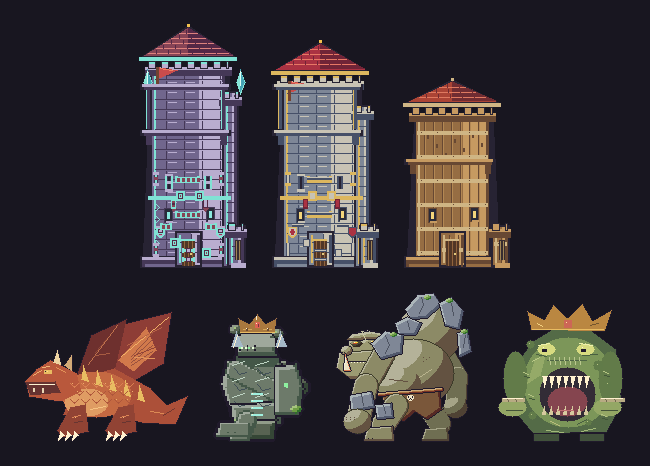
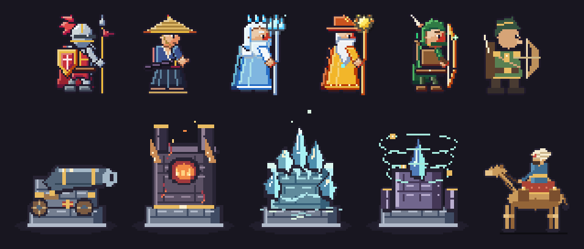
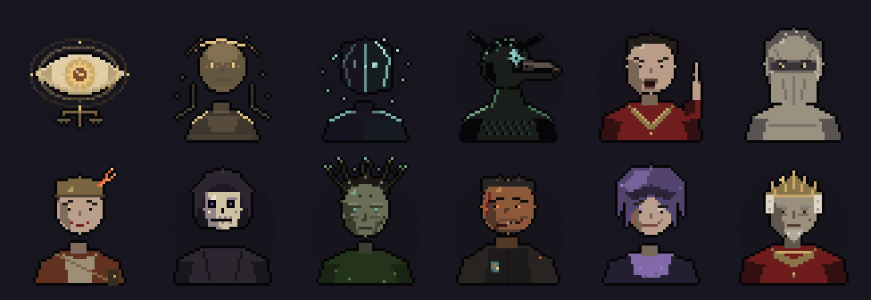
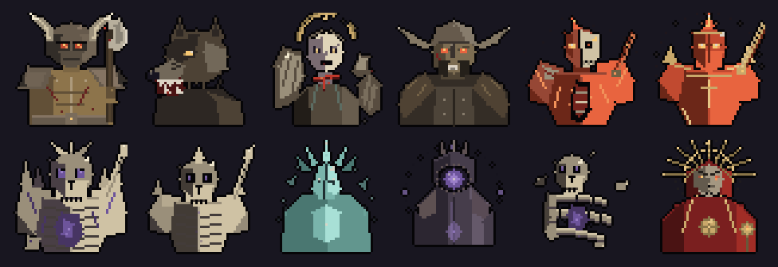
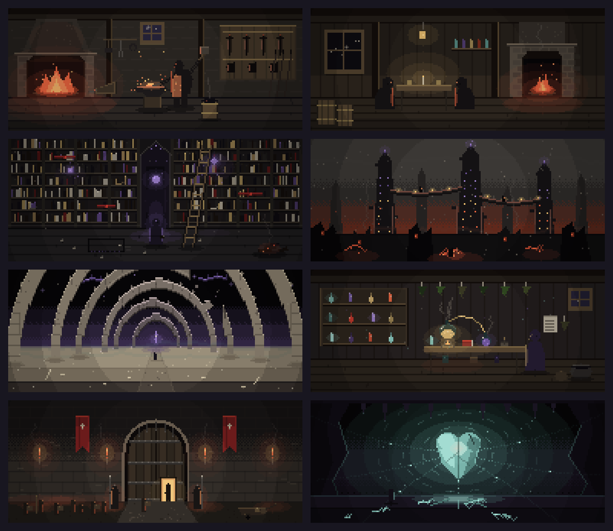

# pixel-art-engine

Kodla, piksel piksel çizilen piksel sanat motoru. Yapay zekâ, diffusion ya da hazır
asset yok: her sprite, bina ve sahne matematikle (şekil, palet, ışık, outline)
üretilir. TypeScript; çizim çekirdeği bağımlılıksız, GIF dışa aktarımı için yalnız
`gifenc` kullanılır.

## Bu teknikle yaptıklarımız

**Tower Defence** — 2D yatay bir telefon oyunu. Bütün sanat hattı bu motorla
üretiliyor (Painter → PNG/atlas → Phaser). Kale seviyeleri ve bosslar:



Kahramanlar ve savunma binaları (3× büyütülmüş):



**Veyra** — Türkçe/İngilizce anlatı RPG'si. Motorun çıktığı ilk çizim
betikleri burada yazıldı; aşağıdakiler o betiklerle üretildi.







## Hızlı başlangıç

```ts
import { writeFileSync } from "node:fs";
import { Painter } from "./src/index.js";
import { encodePng } from "./src/output/png.js"; // Node-only, ayrı import

const p = new Painter(64, 48);
p.fill("#0d0b10");
p.ellipse(32, 24, 10, 8, "#8aab52");
writeFileSync("out.png", encodePng(p));
```

```bash
npm install
npm test          # derler ve testleri çalıştırır
npm run examples  # önce/sonra tarif örneğini reports/ altına üretir
npm run examples:pixel-logic  # renk rampası, AA, sel-out, lint, dither tablosu
```

Tarayıcıda `src/output/canvas.ts` ile doğrudan Canvas'a çizilir; Node'da
`src/output/png.ts` bağımlılıksız PNG yazar.

## Nereden okunur

- [GUIDE.md](GUIDE.md) — kısa başlangıç rehberi ve iş döngüsü
- [recipes/](recipes/) — bina, manzara, iç mekân, animasyon, UI tarifleri
- Teknik temelleri (çizgi, AA, renk, okunurluk, dither, perspektif, temizlik,
  subpiksel): Pixel Logic kitabından özet, bkz. [GUIDE.md](GUIDE.md) ve
  [recipes/SOURCES.md](recipes/SOURCES.md)
- [reference/API.md](reference/API.md) — fonksiyon başvurusu
- [demo/](demo/) — motorun sınırlarını deneyen sahne kodları

## Lisans

[MIT](LICENSE)
