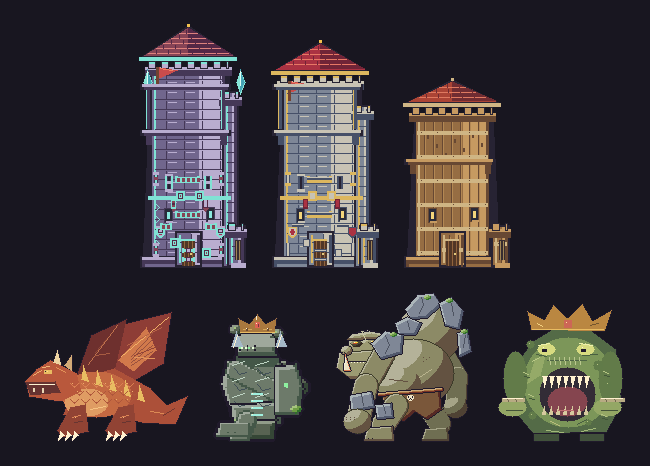
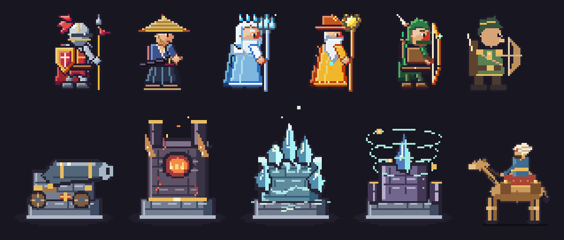
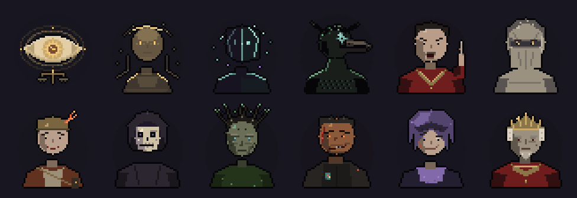
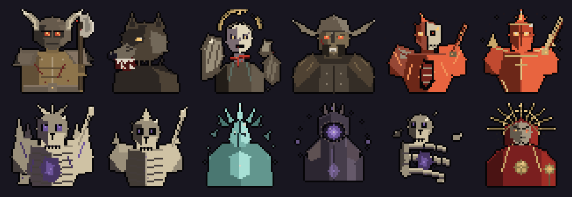
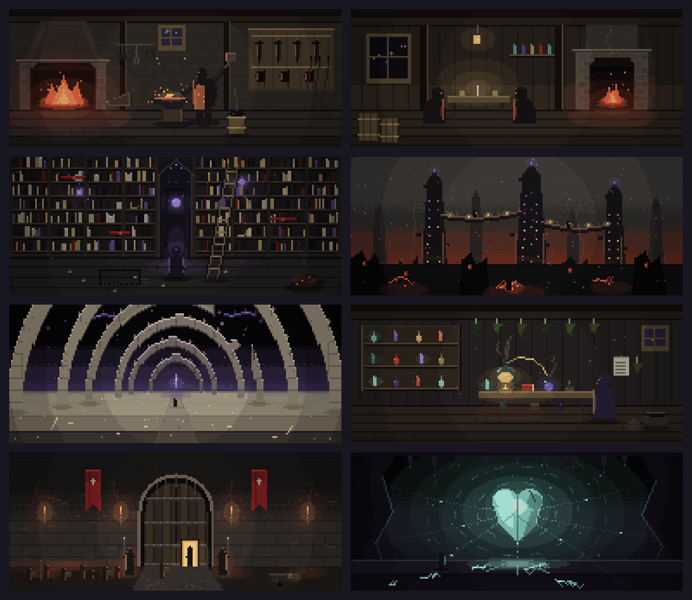

# pixel-art-engine

Kodla, piksel piksel çizilen piksel sanat motoru. Temel çizim hattında yapay zekâ,
diffusion ya da hazır asset yok: sprite, bina ve sahneler matematikle (şekil, palet,
ışık, outline) üretilir. İsteğe bağlı karma görüntü hattı dış görselleri de işler. TypeScript; çizim çekirdeği bağımlılıksız, GIF dışa aktarımı için yalnız
`gifenc` kullanılır.

## Bu teknikle yaptıklarımız

**Tower Defence** — 2D yatay bir telefon oyunu. Bütün sanat hattı bu motorla
üretiliyor (Painter → PNG/atlas → Phaser). Kale seviyeleri ve bosslar:



Kahramanlar ve savunma binaları (3× büyütülmüş):



**Veyra** — Türkçe/İngilizce anlatı RPG'si. Motorun çıktığı ilk çizim
betikleri burada yazıldı; aşağıdakiler o betiklerle üretildi.







## Hızlı başlangıç

```ts
import { writeFileSync } from "node:fs";
import { Painter } from "./src/index.js";
import { encodePng } from "./src/output/png.js"; // Node-only, ayrı import

const p = new Painter(64, 48);
p.fill("#0d0b10");
p.ellipse(32, 24, 10, 8, "#8aab52");
writeFileSync("out.png", encodePng(p));
```

```bash
npm install
npm test          # derler ve testleri çalıştırır
npm run examples  # önce/sonra tarif örneğini reports/ altına üretir
```

Tarayıcıda `src/output/canvas.ts` ile doğrudan Canvas'a çizilir; Node'da
`src/output/png.ts` bağımlılıksız PNG yazar.

Üretilen sprite Aseprite'ta rötuşlanabilir: `src/output/aseprite.ts` kareleri,
katmanları ve animasyon etiketlerini `.aseprite` dosyasına yazar.

```ts
import { encodeAseprite } from "./src/output/aseprite.js"; // Node-only, ayrı import

writeFileSync("okcu.aseprite", encodeAseprite({
  frames: [
    { delayMs: 120, layers: [{ name: "govde", painter: a1 }, { name: "yay", painter: a2 }] },
    { delayMs: 120, layers: [{ name: "govde", painter: b1 }, { name: "yay", painter: b2 }] },
  ],
  tags: [{ name: "atis", from: 0, to: 1 }],
}));
```

## Yeni (Kasım 2026): karma görüntü hattı, organik çizim, zamanlı efektler

Kodla çizimin yanına isteğe bağlı **karma görüntü hattı** eklendi: dışarıdan gelen
bir görseli (yapay zekâ çıktısı dahil) piksel ızgarasına ve sınırlı palete oturtur.
`resizeArea` alfa ağırlıklı küçültür ve yeni `Painter` döndürür; `chromaKey`,
`quantizeKMeans` ve `despeckle` verilen resmi yerinde işler. PNG okuma şimdilik
8-bit, interlace olmayan RGB/RGBA ile sınırlı.

```ts
import { readFileSync, writeFileSync } from "node:fs";
import { resizeArea, chromaKey, quantizeKMeans, despeckle } from "./src/index.js";
import { decodePng, encodePng } from "./src/output/png.js"; // Node-only

const source = decodePng(readFileSync("kaynak.png"));
chromaKey(source, { key: "#ff00ff" });
const sprite = resizeArea(source, 64); // en fazla kaynak genişliği; yükseklik orantılı
quantizeKMeans(sprite, 16, { seed: 7 });
despeckle(sprite, 6);
writeFileSync("sprite.png", encodePng(sprite));
```

Organik kenarlar için `stroke`, `wobblePoly`, `erode`, `roughTower`; tekrarlanabilir
gürültü için `H32`, `vnoise`, `fbm` var. Zamanlı efektler `Particles` ile kıvılcım,
toz ve seken parça üretir; `FxFrame` renk/ışık katmanlarını ayırır, `composite`
ışığı Bayer titreşimiyle kademelendirir. `renderEffect` varsayılan 1/120 saniyelik
sabit adımla çalışır; aynı tohum aynı kareleri üretir.

```ts
import { Painter, stroke, erode, fbm, renderEffect, sparkBurst, contactSheet } from "./src/index.js";

const rock = new Painter(32, 32);
rock.ellipse(16, 16, 10, 8, "#927a58");
stroke(rock, 8, 16, 24, 12, "#c9b28a", 2, 7);
erode(rock, 0.3, 7);
const height = fbm(0.5, 1.2, 4);
const frames = renderEffect(sparkBurst, { seed: 7, opts: { depth: 8 } });
const preview = contactSheet(frames, { cols: 6, scale: 2 });
```

`encodeSheet` tek satırlık PNG, animasyon/süre/pivot JSON'u ve etiketli Aseprite
verisini birlikte döndürür; dosyaları çağıran yazar. `events` ve `hitStopMs`
anahtarları animasyon listesindeki sıfır tabanlı kare sıralarıdır; motor bu
metadata'yı çalıştırmaz.

```ts
import { Painter } from "./src/index.js";
import { encodeSheet } from "./src/output/sheet.js"; // Node-only

const idle = new Painter(32, 32);
idle.ellipse(16, 16, 6, 8, "#927a58");
const sheet = encodeSheet({
  frames: [idle],
  pivot: [16, 30],
  animations: { idle: { frames: [0], delays: [120] } },
}); // sheet.png: Buffer, sheet.json: string, sheet.aseprite: Buffer
```

**Davranış değişikliği:** `px(x, y, c)` artık düz RGBA üzerinde Porter-Duff
source-over harmanlar. Saydam hedefe yarı saydam renk yazınca RGB koyulaşmaz;
yarı saydam katmanların alfa değeri de birleşir. Opak hedefte önceki sonuç korunur.
Saydam sprite, ışık ve sis çıktılarınızı bu değişiklikle yeniden gözden geçirin.

## Nereden okunur

- [GUIDE.md](GUIDE.md) — kısa başlangıç rehberi ve iş döngüsü
- [recipes/](recipes/) — bina, manzara, iç mekân, animasyon, UI tarifleri
- [reference/API.md](reference/API.md) — fonksiyon başvurusu
- [demo/](demo/) — motorun sınırlarını deneyen sahne kodları

## Lisans

[MIT](LICENSE)
