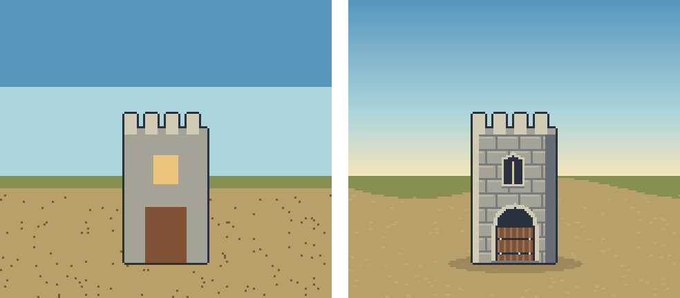
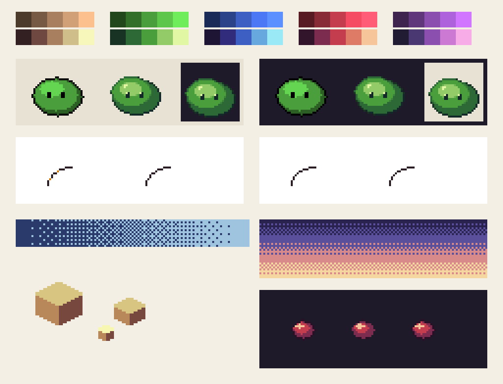

# Görsel örnek: aynı sahne, farklı kararlar

Kaynak: demo/recipes.ts. İki panelde kule silueti ve ana yerleşim aynı tutuldu.
Solda düz yüzeyler, eşikli gökyüzü, tekdüze küçük doku var. Sağda yönlü ışık,
taş derzleri, gömülü kapı/mazgal, nesne altında gölge ve smooth gökyüzü var.
Bu bir model karşılaştırması değil; hangi görsel kararın ne kattığını gösteren tarif.

Native kontrol: reports/recipe-comparison-native.png. Sağdaki küçük pencere
native ölçekte dar okunur; daha karmaşık amblem eklemek yerine boyut artırmak
veya detay azaltmak gerekir. Taş derzleri daha sakin istenirse palette.joint'i
face rengine yaklaştır. Gerçek oyunda kalenin tüm seviyeleri ayrıca kontrol edilir.

## Yeniden üret

Motor kökünde npm install, sonra npm run examples.
Görseller yalnız öğretici motor çıktısıdır; Tower Defense sanatına uygulanmadı.

# Pixel Logic teknik tablosu

Kaynak: demo/pixel-logic.ts (`npm run examples:pixel-logic`). Native: reports/pixel-logic-native.png.
Lint bulgularının tam listesi aynı komutun çıktısında yazdırılır; sayılar lint
kurallarıyla birlikte değişebileceği için burada tekrarlanmaz.

1. **Rampalar:** her rengin üst sırası yalnız `shade` ile koyulaştırma/açma,
   alt sırası `hueRamp` (gölge mora, ışık sarıya kayar).
2. **Slime:** her panelde solda düz `ellipse` (tam sayı yarıçap) + `shade` + saf siyah
   `outline`: lint dört uçta `nub` ve `pureBlack` bildirir. Ortada `hueRamp` +
   `aaEllipse` (.5 yarıçap) + `selectiveOutline`: lint temiz. Sol panel açık,
   sağ panel koyu zemin; köşedeki kutu ters zemini gösterir.
3. **Eğri:** solda karıştırılmış adımlar `[3,1,2]` + `[2,1,3,4]`, lint işaretli
   (turuncu) ve işaretsiz; sağda motorun `ellipse(…,11.5,8.5)` çeyreğinden alınan
   temiz adımlar `[3,2,1,1]` + `[2,3,4]`.
4. **Dither:** 0..16 sıralı seviye şeridi; `ditherBands` ile bantlı gökyüzü.
5. **İzometrik:** `isoBox`, yüz renkleri `hueRamp`'ten.
6. **Subpiksel:** orijinal, `subpixelShift(..., 1, 0)` yarım piksel taslağı, tam piksel kayma.
