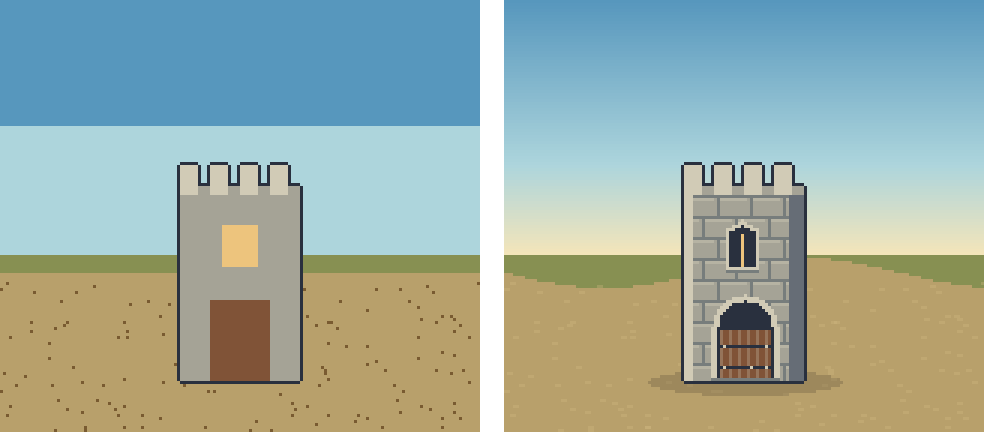

# Görsel örnek: aynı sahne, farklı kararlar

Kaynak: demo/recipes.ts. İki panelde kule silueti ve ana yerleşim aynı tutuldu.
Solda düz yüzeyler, eşikli gökyüzü, tekdüze küçük doku var. Sağda yönlü ışık,
taş derzleri, gömülü kapı/mazgal, nesne altında gölge ve smooth gökyüzü var.
Bu bir model karşılaştırması değil; hangi görsel kararın ne kattığını gösteren tarif.

Native kontrol: reports/recipe-comparison-native.png. Sağdaki küçük pencere
native ölçekte dar okunur; daha karmaşık amblem eklemek yerine boyut artırmak
veya detay azaltmak gerekir. Taş derzleri daha sakin istenirse palette.joint'i
face rengine yaklaştır. Gerçek oyunda kalenin tüm seviyeleri ayrıca kontrol edilir.

## Yeniden üret

Motor kökünde npm install, sonra npm run examples.
Görseller yalnız öğretici motor çıktısıdır; Tower Defense sanatına uygulanmadı.
